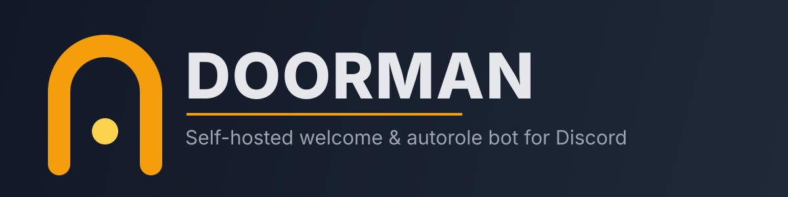

# Doorman

<p align="center"></p>

Bot Discord self-hosted per community: autorole, card di benvenuto con banner, ruoli per invito e coda di approvazione per account troppo giovani. Dashboard con login Discord; comandi `/doorman-status` e `/doorman-pending` per chi può gestire il server.

**In sviluppo:** il filtro per età non è una protezione anti-raid completa; l'attribuzione degli inviti è best-effort. Non assegnare automaticamente ruoli amministrativi.

## Avvio

Servono Docker Engine/Desktop con container Linux, Compose v2 recente, Bash e OpenSSL.

```bash
git clone --config core.autocrlf=false https://github.com/PrimeBuild-pc/Doorman.git
cd Doorman
bash install.sh
```

Prima prepara l'app Discord con la [guida self-hosting](docs/self-hosting.md): intent, OAuth, permessi minimi e gerarchia dei ruoli. L'installer nasconde token e Client Secret, genera password casuali, **non sovrascrive `.env`** e chiede conferma prima di scaricare/avviare servizi. La dashboard resta su `127.0.0.1:3000`; accesso remoto solo con HTTPS o tunnel SSH.

Dopo l'avvio apri `http://localhost:3000`, accedi con Discord, scegli il server e salva ruoli/canale. Per un homelab remoto usa il tunnel SSH della guida prima di aprire il browser.

## Più server, stessa installazione

Invita la stessa app in ogni server desiderato; ruoli, banner, inviti e approvazioni sono separati per ID server. Ogni accesso alle impostazioni o modifica verifica i permessi correnti su Discord e la presenza del bot. Solo ruoli non privilegiati, anche negli override dei canali, e sotto Doorman sono assegnabili. Un errore Discord non viene registrato come approvazione riuscita.

Le richieste di ingressi precedenti vengono superate; gli ingressi simultanei con inviti ambigui non ricevono il ruolo per invito. Questa è un'installazione per community fidate, **non un servizio pubblico multi-tenant** né una prova d'identità dei membri.

## Architettura e costi

`apps/bot` (discord.js) e `apps/web` (Next.js) condividono PostgreSQL (`packages/database`) e il volume dei banner. Compose esegue prima un unico job di schema, poi bot e web, come utenti non-root. Il codice è TypeScript in un monorepo pnpm.

Nessun modello AI, chiave LLM o abbonamento AI serve al bot. Gli eventuali abbonamenti di un coding agent sono strumenti di sviluppo separati: non finanziano né ospitano Doorman. Restano i costi del tuo host, storage/backup, rete ed eventuale dominio. Discord riceve richieste API, messaggi e immagini di benvenuto; database e banner originali risiedono sul tuo host.

- [Installazione, configurazione, backup, aggiornamento e troubleshooting](docs/self-hosting.md)
- [Sviluppo e verifiche locali](docs/development.md)
- [Verifiche infrastruttura senza deploy](docs/infra-checks.md)
- [Assistenza sicura da un agent](docs/agent-operations.md)

Licenza [MIT](LICENSE).
